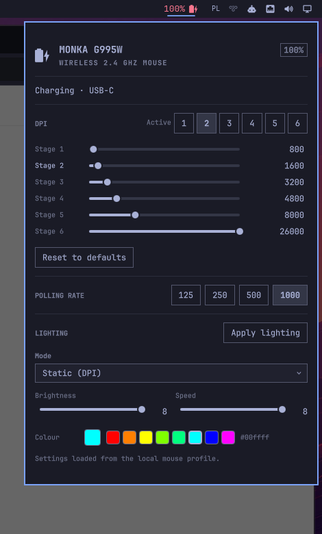

# MONKA G995W for Omarchy

A battery, DPI, polling-rate and lighting widget for the **MONKA G995W**
2.4 GHz wireless mouse, built for the Omarchy shell.

The mouse exposes its settings through vendor HID feature reports. This plugin
talks to them directly; the Windows driver is not needed.



## Features

- Battery percentage in the bar, with one low-battery notification.
- Live battery updates from the mouse's passive status reports.
- Six editable DPI stages, active-stage selection, and reset to defaults.
- Polling rate: 125 / 250 / 500 / 1000 Hz.
- Lighting: mode, brightness, speed and RGB colour.
- Notification showing the stage and DPI when the mouse's own DPI button is
  used.
- Works with the wireless dongle (`1d57:fa60`) and USB-C (`1d57:fa61`).
- Bluetooth mode is not supported: it presents a different BLE HID interface
  without the vendor report collections.

## Requirements

- Omarchy Quattro.
- Python 3.
- Read/write access to the mouse's vendor HID interface. Install the included
  udev rule once:

```sh
sudo install -m 0644 70-monka-g995w.rules /etc/udev/rules.d/70-monka-g995w.rules
sudo udevadm control --reload-rules
sudo udevadm trigger --subsystem-match=hidraw
```

## Install

```sh
omarchy plugin add https://github.com/cichowlasp/omarchy-monka-g995w.git --enable
omarchy bar move io.github.cichowlasp.monka-g995w --section right
```

If the widget is not in the bar after install, restart the shell:

```sh
omarchy restart shell
```

## Usage

Click the battery icon in the bar to open the panel.

- **DPI** — drag a slider or click a value and type a DPI. Changes are applied
  automatically. Clicking a stage number makes it active and applies the
  current values. *Reset to defaults* restores
  `800 / 1600 / 3200 / 4800 / 8000 / 26000`.
- **Polling rate** — click one of the four rates; it is applied immediately.
- **Lighting** — choose a mode, brightness, speed and colour, then click
  *Apply lighting*.

The mouse cannot report its current configuration back to the host, so the
plugin keeps a local copy in `~/.local/state/monka-g995w.json`, the same way
the Windows application keeps an on-disk profile.

## Configuration

The widget settings live in `~/.config/omarchy/shell.json`:

```json
{
  "id": "io.github.cichowlasp.monka-g995w",
  "lowBatteryThreshold": 10,
  "refreshIntervalSec": 60
}
```

- `lowBatteryThreshold` — percentage for the low-battery notification.
- `refreshIntervalSec` — fallback battery poll interval; live status reports
  update the bar continuously.

## Uninstall

```sh
omarchy plugin remove io.github.cichowlasp.monka-g995w
sudo rm /etc/udev/rules.d/70-monka-g995w.rules
```

## License

MIT. See [LICENSE](LICENSE).
